# SWAR AI

> **Your Voice. Your Language. Your Intelligence.**  
> *Everyone Deserves to Be Heard.*

[](https://react.dev/)
[](https://www.typescriptlang.org/)
[](https://vite.dev/)
[](https://expressjs.com/)
[](https://supabase.com/)
[](https://opencode.ai/)

SWAR AI is a voice-first, multilingual AI assistant web application built with React, TypeScript, Express, Supabase, and OpenCode Inference. It is designed to make AI interaction more accessible through text and voice, with support for English, Telugu, and Hindi.

**Repository:** [yenuglaganesh-dev/swar-ai-](https://github.com/yenuglaganesh-dev/swar-ai-)

---

## Table of Contents

- [About SWAR AI](#about-swar-ai)
- [Project Overview](#project-overview)
- [Problem Statement](#problem-statement)
- [Proposed Solution](#proposed-solution)
- [Project Objectives](#project-objectives)
- [Key Features](#key-features)
- [Application Screenshots](#application-screenshots)
- [Page-by-Page Documentation](#page-by-page-documentation)
- [How the System Works](#how-the-system-works)
- [System Architecture](#system-architecture)
- [Technology Stack](#technology-stack)
- [Project Structure](#project-structure)
- [Installation Guide](#installation-guide)
- [Environment Variables](#environment-variables)
- [Frontend Setup](#frontend-setup)
- [Backend Setup](#backend-setup)
- [Supabase Configuration](#supabase-configuration)
- [OpenCode AI Integration](#opencode-ai-integration)
- [Voice Processing](#voice-processing)
- [Language Support](#language-support)
- [Security and Privacy](#security-and-privacy)
- [Current Implementation Status](#current-implementation-status)
- [Future Roadmap](#future-roadmap)
- [Developer Profile](#developer-profile)
- [Repository Information](#repository-information)
- [Contribution Guidelines](#contribution-guidelines)
- [License](#license)

---

## About SWAR AI

SWAR AI is a full-stack AI assistant project focused on voice-first interaction and multilingual accessibility. The application combines a React frontend, an Express API backend, Supabase authentication/data services, and OpenCode Inference for chat completions. The interface uses a dark, orange-accented visual identity and includes a reusable animated `SwarAICircle` component used on key pages.

## Project Overview

| Area | Details |
|---|---|
| **Project name** | SWAR AI |
| **Tagline** | Your Voice. Your Language. Your Intelligence. |
| **Application type** | Full-stack web application |
| **Frontend** | React 19 + TypeScript + Vite |
| **Backend** | Node.js + Express |
| **Authentication/Data** | Supabase |
| **AI provider integration** | OpenCode Inference Chat Completions API |
| **Voice** | Web Speech API (SpeechRecognition) + Speech Synthesis |
| **Supported UI/assistant languages** | English (`en-IN`), Telugu (`te-IN`), Hindi (`hi-IN`) |

## Problem Statement

Many AI interfaces assume users are comfortable typing, reading long responses, or interacting in English. This creates friction for users who prefer voice interaction, users with limited typing comfort, and multilingual users who want to communicate in Telugu or Hindi.

## Proposed Solution

SWAR AI provides a voice-first assistant interface with text input fallback, multilingual language selection, speech recognition, text-to-speech output, and an accessible conversational UI. It includes Supabase-based authentication and user data features, while routing AI requests through a backend API to avoid exposing provider keys in the browser.

## Project Objectives

- Provide a voice-first AI assistant experience.
- Support multilingual interaction in English, Telugu, and Hindi.
- Offer accessible controls including large microphone interaction, speech output, and simple UI states.
- Keep AI provider credentials on the backend.
- Use Supabase for authentication, profiles, conversations, memories, and usage tracking.
- Present the project as a maintainable, developer-documented repository.

## Key Features

- **Multilingual assistant UI** — Language context and translation files for English, Telugu, and Hindi.
- **Voice input** — Browser SpeechRecognition integration where supported.
- **Text-to-speech output** — Browser SpeechSynthesis integration with voice selection heuristics.
- **AI chat backend** — Express `/api/chat` endpoint proxies requests to OpenCode Inference.
- **Supabase authentication** — Email/password sign-in, sign-up, Google OAuth initiation, password reset flow.
- **Protected routes** — Profile and dashboard routes require authenticated user.
- **User settings** — Language, auto-detect, speech rate, easy mode, continuous mode, memory/history/audio preferences.
- **Conversation features** — Chat history state, suggestions, conversation persistence hooks, memory candidate handling.
- **Document/image inputs** — Assistant page includes document upload and camera/image capture UI.
- **Weather and news endpoints** — Backend endpoints for OpenWeatherMap and NewsAPI when configured.
- **Animated SwarAICircle** — Reusable SVG/CSS animated AI circle component used on homepage and auth visual.
- **Responsive layout** — Desktop and mobile layouts with dark SWAR AI theme.

## Application Screenshots

> Screenshots were captured from the locally running application on **November 24, 2026** using Microsoft Edge (headless) via Puppeteer. Protected routes (`/profile`, `/dashboard`) redirect to `/auth` when no authenticated session is present; those screenshots document the actual redirect behavior. No credentials, API keys, or private user data are exposed.

### Desktop Screenshots

| Page | Preview |
|---|---|
| Homepage | 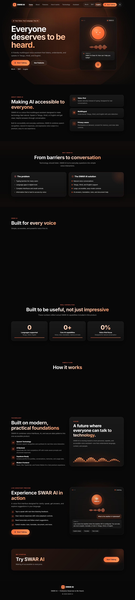 |
| AI Assistant | 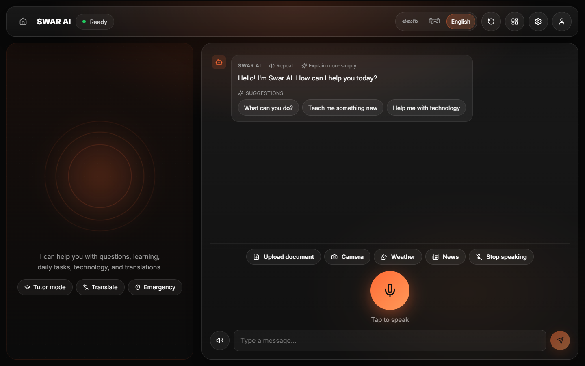 |
| Assistant Chat Input |  |
| Language Selector | 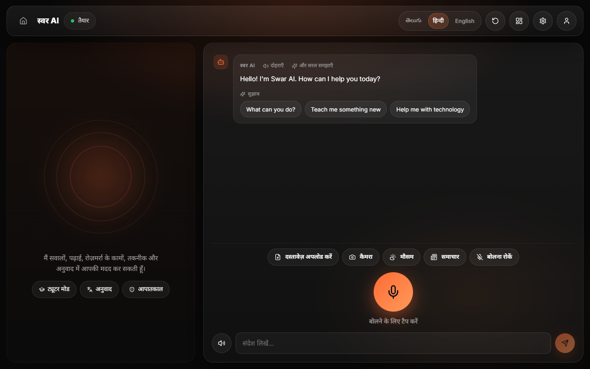 |
| Assistant Settings | 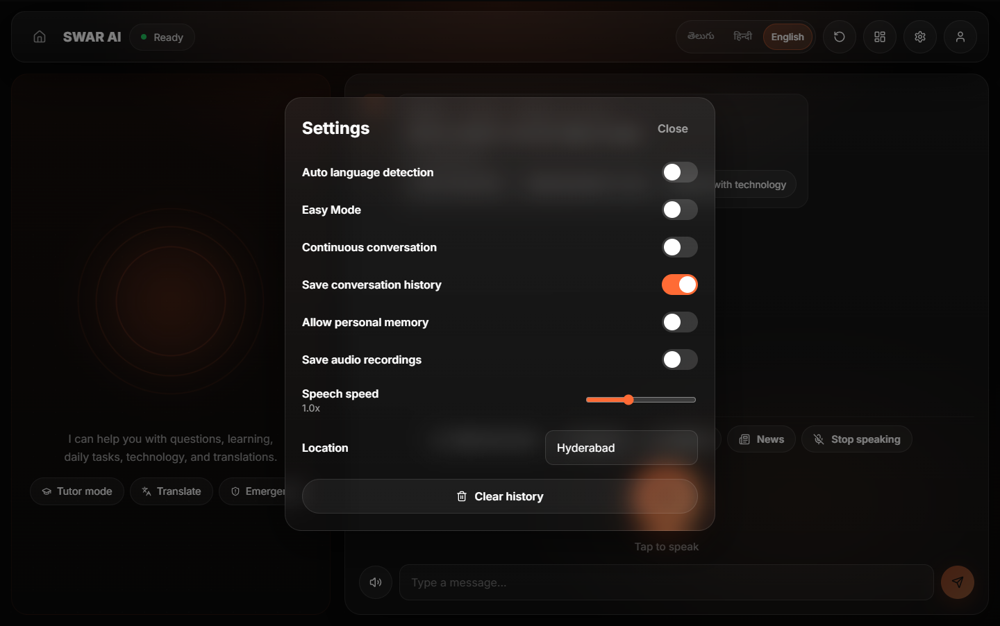 |
| Login |  |
| Registration | 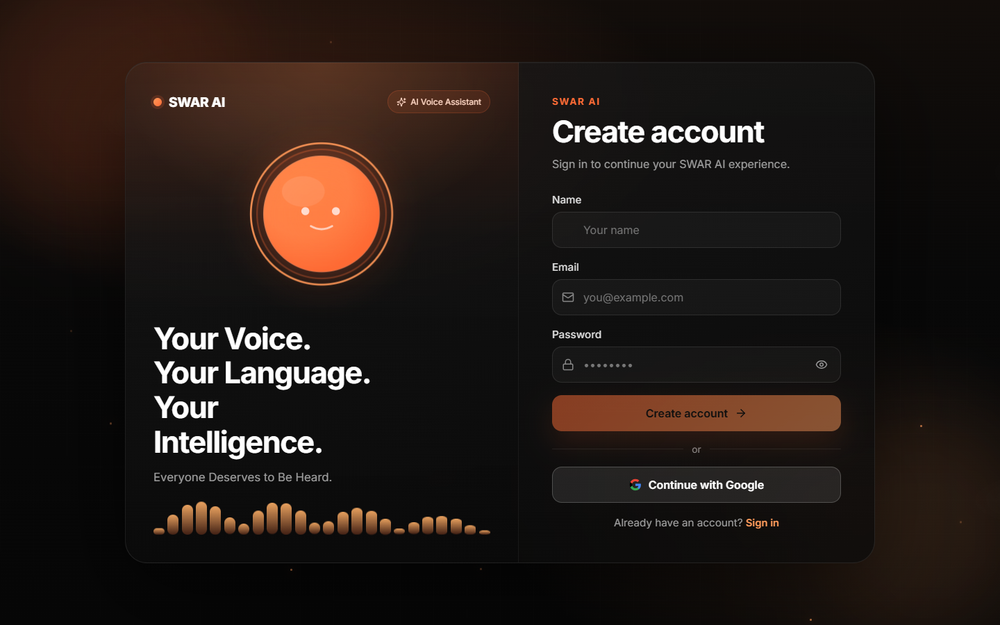 |
| Forgot Password | 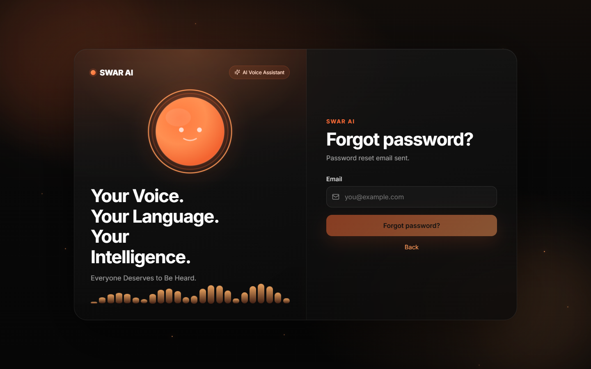 |
| Profile Route (redirect behavior) | 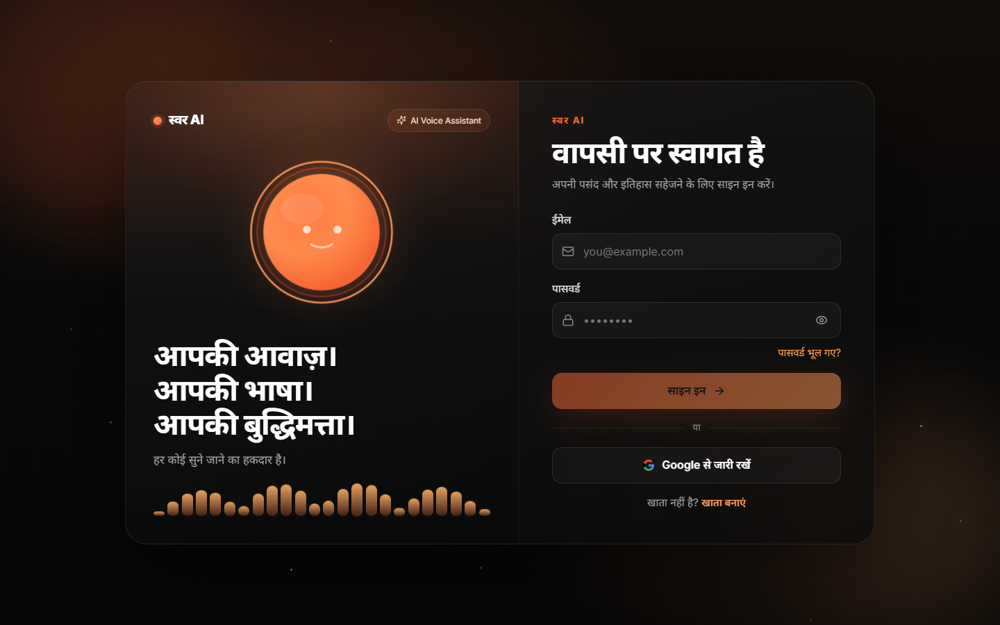 |
| Dashboard Route (redirect behavior) |  |

### Mobile Screenshots

| Page | Preview |
|---|---|
| Homepage (Mobile) |  |
| AI Assistant (Mobile) | 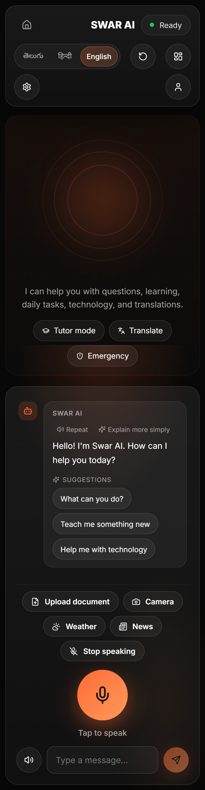 |
| Login (Mobile) | 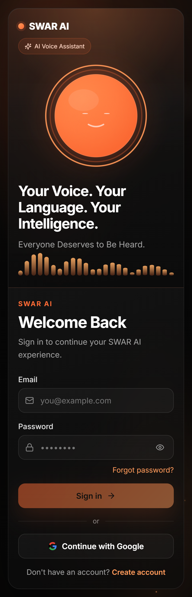 |
| Registration (Mobile) | 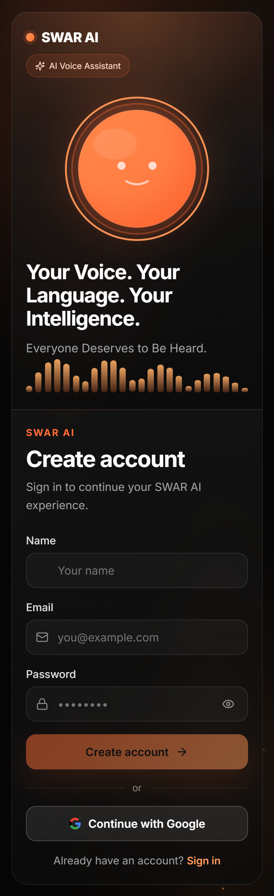 |
| Assistant Settings (Mobile) | 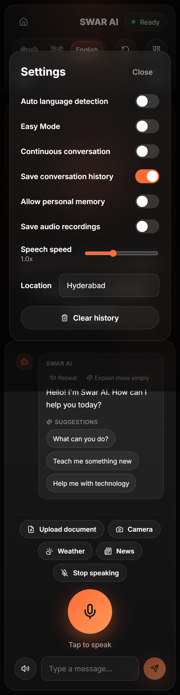 |

## Page-by-Page Documentation

Detailed page descriptions are available in [docs/SCREENSHOTS.md](docs/SCREENSHOTS.md).

## How the System Works

1. User opens the SWAR AI frontend.
2. User interacts by typing or using microphone input.
3. SpeechRecognition (when available) converts voice to text.
4. Frontend sends chat requests to the Express backend `/api/chat`.
5. Backend builds system prompt/context and calls OpenCode Inference Chat Completions.
6. Backend returns structured response (`reply`, `detectedLanguage`, `suggestions`, optional memory candidate/error details).
7. Frontend displays the response and can speak it using SpeechSynthesis.
8. Supabase handles authentication and stores user-related data when configured.

## System Architecture

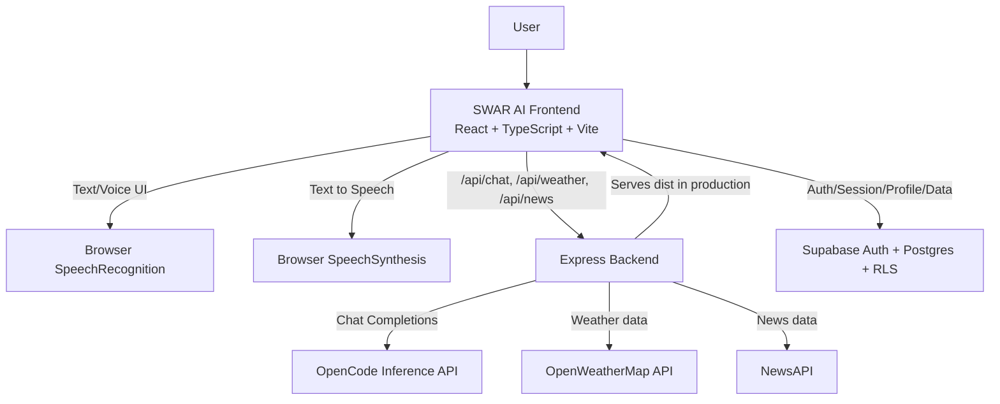

More details: [docs/ARCHITECTURE.md](docs/ARCHITECTURE.md).

## Technology Stack

| Category | Technology | Evidence |
|---|---|---|
| Frontend framework | React 19 | `package.json` |
| Language | TypeScript | `package.json`, `tsconfig.json`, `.ts/.tsx` sources |
| Build tool | Vite 6 | `package.json`, `vite.config.ts` |
| Routing | React Router DOM 7 | `package.json`, `src/App.tsx` |
| Animation | Framer Motion | `package.json`, UI components |
| Icons | Lucide React | `package.json`, UI components |
| Backend | Node.js, Express 4 | `package.json`, `server/index.js` |
| AI integration | OpenCode Inference Chat Completions endpoint | `server/index.js`, `.env.example` |
| Auth/database | Supabase JS + SQL schema | `package.json`, `src/services/supabase*.ts`, `supabase/schema.sql` |
| Speech recognition | Web Speech API | `src/services/speechRecognition.ts` |
| Speech synthesis | Browser SpeechSynthesis API | `src/services/speechSynthesis.ts` |
| External data APIs | OpenWeatherMap, NewsAPI (optional) | `server/index.js`, `.env.example` |

## Project Structure

```text
.
├── docs/
│   ├── ARCHITECTURE.md
│   ├── SCREENSHOTS.md
│   └── screenshots/
│       ├── desktop/
│       └── mobile/
├── scripts/                    # Development/patch/helper scripts
├── server/
│   └── index.js                # Express API, AI proxy, weather/news, static serving
├── src/
│   ├── App.tsx                 # Routes and protected route wrapper
│   ├── main.tsx                # App bootstrap
│   ├── components/
│   │   ├── Auth/               # SwarMascot wrapper
│   │   ├── Layout/             # Navbar, PageShell, LanguageSelector
│   │   ├── Marketing/          # Homepage sections
│   │   ├── Mascot/             # SwarAICircle animated component
│   │   └── VoiceAssistant/      # Assistant UI components
│   ├── context/                # Auth, Language, Settings providers
│   ├── i18n/                   # translations.ts
│   ├── pages/                  # Home, Assistant, Auth, Profile, Dashboard
│   ├── services/               # AI, speech, Supabase, storage, data store
│   ├── styles/                 # global.css
│   └── types/                  # shared TypeScript types
├── supabase/
│   └── schema.sql              # Tables, RLS policies, triggers
├── .env.example
├── package.json
├── tsconfig.json
├── vite.config.ts
└── README.md
```

## Installation Guide

### Prerequisites

- **Node.js** 18+ (recommended: current LTS)
- **npm** 9+
- **Git**
- A modern browser (Chrome/Edge recommended for SpeechRecognition support)

### Clone

```bash
git clone https://github.com/yenuglaganesh-dev/swar-ai-.git
cd swar-ai-
```

### Install dependencies

```bash
npm install
```

### Configure environment

```bat
copy .env.example .env
```

On macOS/Linux:

```bash
cp .env.example .env
```

Fill required values in `.env`. See [Environment Variables](#environment-variables).

## Environment Variables

| Variable | Required | Purpose |
|---|---:|---|
| `PORT` | No | Express server port (default `3001`) |
| `CLIENT_ORIGIN` | No | CORS origin for frontend (default `http://localhost:5173`) |
| `AI_API_KEY` | For real AI chat | OpenCode Inference API key used by backend |
| `AI_API_URL` | No | Chat completions endpoint; default OpenCode Inference URL |
| `AI_MODEL` | No | Model ID; default `big-pickle` |
| `AI_VISION_MODEL` | No | Vision-capable model for image requests; defaults to `AI_MODEL` |
| `WEATHER_API_KEY` | Optional | OpenWeatherMap API key for `/api/weather` |
| `NEWS_API_KEY` | Optional | NewsAPI key for `/api/news` |
| `DEFAULT_WEATHER_LOCATION` | No | Default weather location |
| `VITE_SUPABASE_URL` | For Supabase auth/data | Supabase project URL |
| `VITE_SUPABASE_ANON_KEY` | For Supabase auth/data | Supabase publishable/anon key |

> **Never commit real API keys, Supabase service-role keys, or private credentials.** `.env` is gitignored; `.env.example` should contain placeholders only.

## Frontend Setup

The frontend runs on Vite (default `http://localhost:5173`) and proxies `/api` to `http://localhost:3001` during development.

```bash
npm run dev:client
```

## Backend Setup

The backend runs on Express (default `http://localhost:3001`).

```bash
npm run dev:server
```

## Run Both (Development)

```bash
npm run dev
```

## Production Build

```bash
npm run build
npm start
```

`npm start` serves `dist/` through Express and exposes API routes.

## Supabase Configuration

1. Create a Supabase project.
2. Copy **Project URL** and **Publishable/Anon key** into `.env`.
3. In Supabase Authentication settings, configure providers as needed:
   - Email/password
   - Google OAuth (requires Google Cloud OAuth client and Supabase provider setup)
4. Add redirect URLs in Supabase URL Configuration, e.g.:
   - `http://localhost:5173/assistant`
   - `http://localhost:5173/auth`
   - Your production domain equivalents
5. Run `supabase/schema.sql` in Supabase SQL editor.
6. Confirm RLS policies are enabled as defined in schema.

## OpenCode AI Integration

- Backend endpoint: `POST /api/chat`
- Default provider URL: `https://opencode.ai/inference/openai/v1/chat/completions`
- Default model: `big-pickle` (configured in env)
- The backend sends chat-completions requests with `Authorization: Bearer <AI_API_KEY>`.
- If AI key/provider is missing or errors, backend returns structured fallback/error information; the UI displays an error state.

**Validation note:** External AI completion depends on a valid configured `AI_API_KEY` and provider availability/quota. Do not claim real AI responses are working without a successful live test.

## Voice Processing

- **Speech recognition:** `src/services/speechRecognition.ts` uses `window.SpeechRecognition` / `webkitSpeechRecognition`.
- **Speech synthesis:** `src/services/speechSynthesis.ts` uses `window.speechSynthesis`.
- Browser support varies; the UI includes fallback messaging and text input.
- Microphone access requires user permission and secure context/browser support.

## Language Support

| Language | Code | Status |
|---|---|---|
| English | `en-IN` | Implemented in language settings/translations |
| Telugu | `te-IN` | Implemented in language settings/translations |
| Hindi | `hi-IN` | Implemented in language settings/translations |

The project includes a centralized translation file (`src/i18n/translations.ts`) and language context. Complete end-to-end parity across every screen/state should be validated manually.

## Security and Privacy

- API keys are loaded from environment variables; AI keys are used server-side.
- Supabase anon/publishable key is used in frontend; service-role keys should never be exposed.
- `.env` is ignored by git.
- Supabase schema includes Row Level Security policies for user-owned tables.
- Do not expose real credentials, tokens, or private user data in screenshots or docs.

## Current Implementation Status

| Feature | Status | Notes |
|---|---|---|
| Homepage marketing UI | Implemented | Route `/` with multiple sections |
| Assistant UI | Implemented | Route `/assistant`, chat/voice/settings controls |
| Speech recognition integration | Partially implemented | Browser-dependent; requires runtime support/permission |
| Speech synthesis integration | Partially implemented | Browser voice availability varies |
| OpenCode AI chat endpoint | Implemented in code | Requires valid `AI_API_KEY` and provider access for live responses |
| Supabase auth (email/password) | Implemented in code | Requires Supabase project configuration |
| Google OAuth | Implemented in code | Requires Supabase + Google Cloud provider configuration; provider must be enabled |
| Password reset | Implemented in code | Requires Supabase email configuration |
| Profile page | Implemented in code | Protected route; redirects to auth when unauthenticated |
| Dashboard page | Implemented in code | Protected route; redirects to auth when unauthenticated |
| Weather endpoint/UI | Partially implemented | Requires `WEATHER_API_KEY`; external API limits apply |
| News endpoint/UI | Partially implemented | Requires `NEWS_API_KEY`; external API limits apply |
| EN/TE/HI language system | Partially implemented | Translation infrastructure exists; full UI parity needs manual audit |
| Reusable SwarAICircle animation | Implemented | Used on homepage and auth visual |
| Documentation screenshots | Implemented | Real local screenshots captured for available states |

## Future Roadmap

- Complete full EN/TE/HI translation coverage across all components and states.
- Add verified live end-to-end tests for AI, weather, and news integrations.
- Improve authenticated screenshot/documentation flow with a safe demo account.
- Add CI checks for lint/build/docs validation.
- Expand accessibility audits (keyboard, screen reader, reduced motion).
- Add deployment documentation for production hosting.

## Developer Profile

| Field | Value |
|---|---|
| **Developer** | Ganesh Yenugula (from git metadata) |
| **GitHub** | [yenuglaganesh-dev](https://github.com/yenuglaganesh-dev) |
| **Repository** | [swar-ai-](https://github.com/yenuglaganesh-dev/swar-ai-) |
| **Project role** | Full-Stack Developer / AI Application Developer (based on repository implementation) |
| **Focus areas** | React + TypeScript frontend, Express backend, Supabase auth/data, AI assistant integration, voice UI |

> Only publicly verifiable repository/git metadata is included. No private contact details, claims of employment, certifications, or awards are added.

## Repository Information

- **Default branch:** `main`
- **Remote:** `https://github.com/yenuglaganesh-dev/swar-ai-.git`
- **Primary app routes:** `/`, `/assistant`, `/auth`, `/profile` (protected), `/dashboard` (protected)

## Contribution Guidelines

1. Fork the repository and create a feature branch.
2. Keep changes focused and documented.
3. Do not commit secrets or `.env` files.
4. Run `npm run build` before opening a pull request.
5. Include screenshots/docs updates for UI changes.

## License

No `LICENSE` file is currently included in this repository. Add one if you intend to distribute the project under a specific open-source license.
