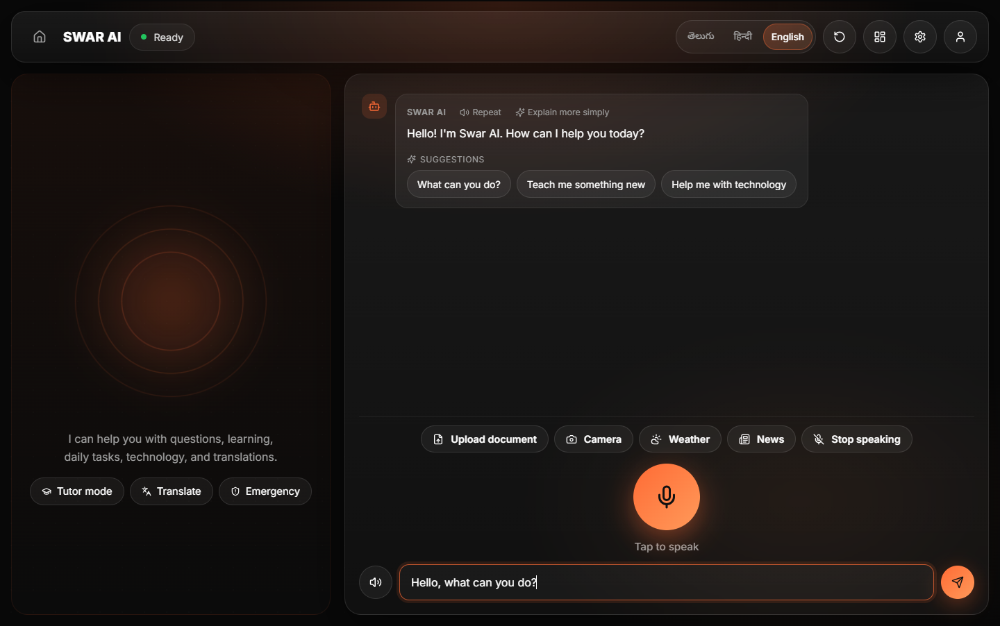
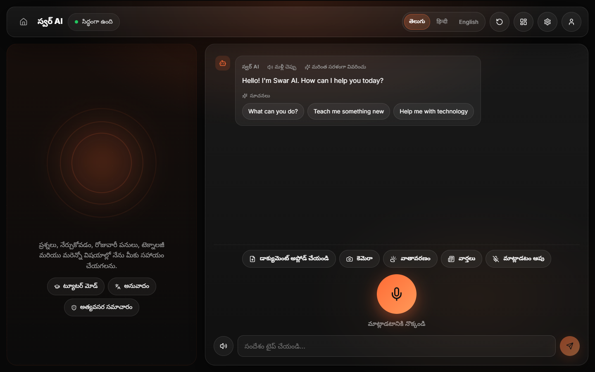
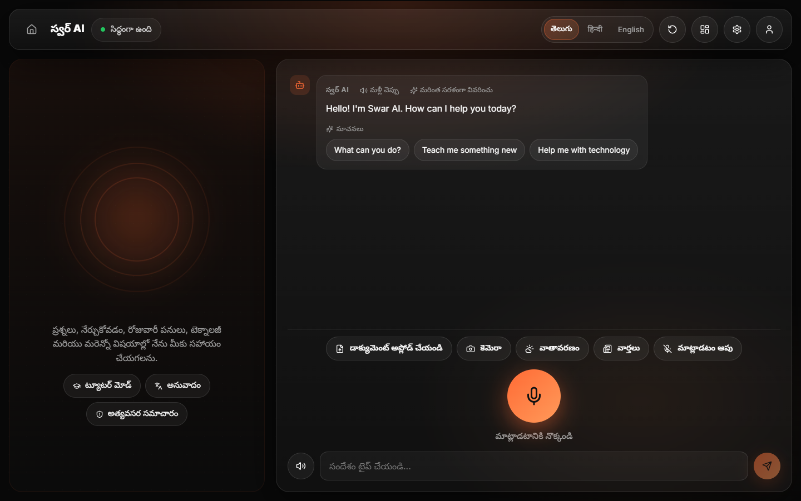
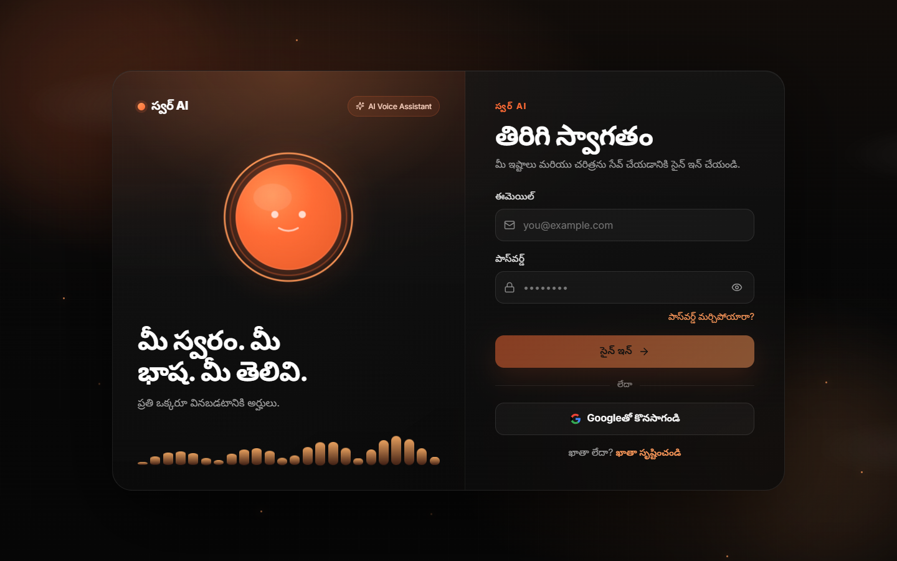
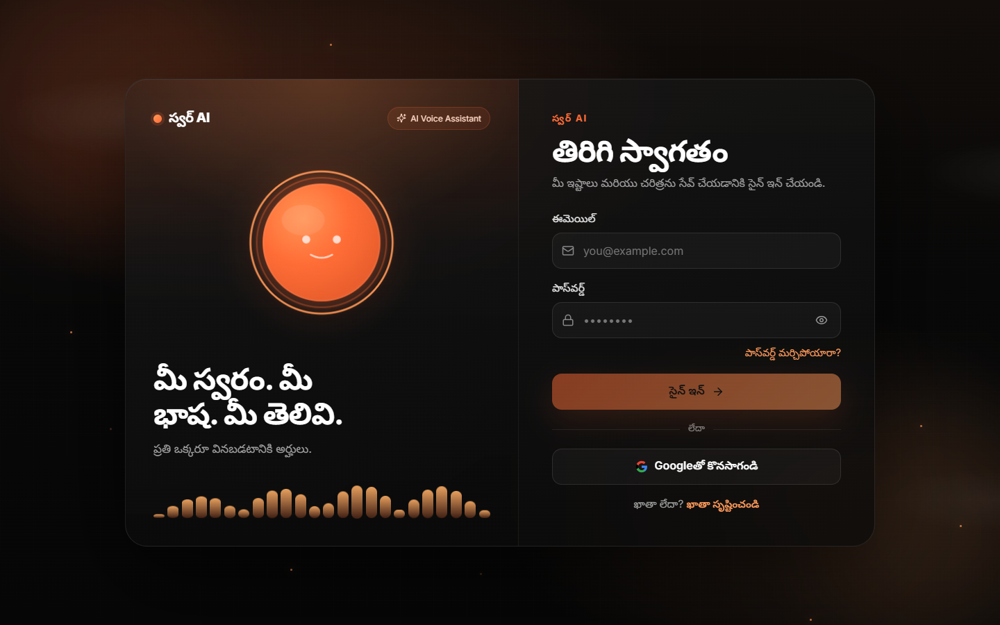
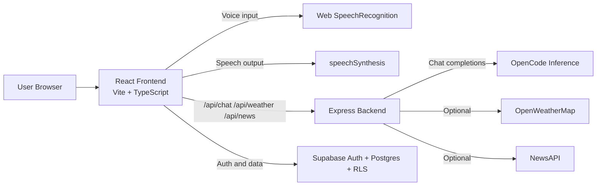

# SWAR AI

> **Your Voice. Your Language. Your Intelligence.**

SWAR AI is a multilingual, voice-first AI assistant web application designed to make AI interaction more accessible through natural language and voice. The repository contains a React + TypeScript frontend, an Express backend, Supabase authentication/data integration, and OpenCode Inference chat integration.

---

## Table of Contents

- [Project Overview](#project-overview)
- [Problem Statement](#problem-statement)
- [Proposed Solution](#proposed-solution)
- [Key Features](#key-features)
- [Application Screenshots](#application-screenshots)
- [Technology Stack](#technology-stack)
- [System Architecture](#system-architecture)
- [Application Workflow](#application-workflow)
- [Project Directory Structure](#project-directory-structure)
- [Frontend Architecture](#frontend-architecture)
- [Backend Architecture](#backend-architecture)
- [API Integration](#api-integration)
- [Database and Authentication](#database-and-authentication)
- [Environment Configuration](#environment-configuration)
- [Installation and Setup](#installation-and-setup)
- [Running the Application](#running-the-application)
- [Available Scripts](#available-scripts)
- [API Endpoints](#api-endpoints)
- [Security and Privacy](#security-and-privacy)
- [Current Limitations](#current-limitations)
- [Future Enhancements](#future-enhancements)
- [Developer Information](#developer-information)
- [Contributing](#contributing)
- [License](#license)

---

## Project Overview

| Field | Details |
|---|---|
| **Project** | SWAR AI |
| **Tagline** | Your Voice. Your Language. Your Intelligence. |
| **Type** | Full-stack web application |
| **Frontend** | React 19, TypeScript, Vite |
| **Backend** | Node.js, Express |
| **AI Integration** | OpenCode Inference Chat Completions API |
| **Authentication/Data** | Supabase (Auth + Postgres + RLS schema) |
| **Voice** | Web Speech API (`SpeechRecognition`) and browser `speechSynthesis` |
| **Languages** | English (`en-IN`), Telugu (`te-IN`), Hindi (`hi-IN`) |
| **Repository** | [yenuglaganesh-dev/swar-ai-](https://github.com/yenuglaganesh-dev/swar-ai-) |

## Problem Statement

Many AI interfaces are optimized for text-first, English-first interaction. Users who prefer speaking, have limited typing comfort, or communicate in regional languages can face barriers when using conventional AI assistants.

## Proposed Solution

SWAR AI implements a voice-capable assistant interface with multilingual language support, text input fallback, speech output, and backend-mediated AI requests. It also includes Supabase-based authentication and user data schema for profiles, conversations, memories, and usage events.

## Key Features

| Feature | Description | Status |
|---|---|---|
| Homepage | Marketing landing page with project sections and CTA | Implemented |
| AI Assistant page | Chat interface with voice/text controls, status, suggestions, settings | Implemented |
| Language support | English, Telugu, Hindi language context and translation dictionary | Partially implemented |
| Speech recognition | Browser SpeechRecognition integration for voice input | Partially implemented (browser-dependent) |
| Text-to-speech | Browser SpeechSynthesis output with voice selection heuristics | Partially implemented (browser-dependent) |
| OpenCode AI chat | Backend `/api/chat` proxy to OpenCode Inference | Implemented in code; requires valid API key for live responses |
| Supabase email/password auth | Sign-in, sign-up, password reset flows | Implemented in code; requires Supabase configuration |
| Google OAuth | Supabase OAuth initiation for Google provider | Implemented in code; requires Supabase + Google Cloud configuration |
| Protected routes | `/profile` and `/dashboard` require authenticated user | Implemented |
| Profile/Dashboard | User settings, history/privacy/memory/usage UI | Implemented in code; authenticated runtime validation required |
| Weather/News APIs | Backend endpoints for OpenWeatherMap and NewsAPI | Partially implemented; requires API keys and external service availability |
| Document/Image input | Assistant UI includes document upload and camera/image capture controls | Implemented in UI; end-to-end behavior depends on runtime/browser support |

## Application Screenshots

> Desktop/laptop screenshots only (1440x900). Captured from the locally running application on November 24, 2026 using Microsoft Edge (headless) via Puppeteer. No credentials, API keys, or private user data are exposed.

### 01. Homepage


The homepage presents the SWAR AI product identity, navigation, hero section with animated `SwarAICircle`, and primary call-to-action to launch the assistant.

### 02. AI Assistant


The assistant page provides the main conversational interface, including assistant status/orb, conversation panel, microphone control, text input, and assistant controls.

### 03. Assistant Chat Input



The assistant interface with chat input interaction visible, showing the text-entry path alongside the voice-first assistant layout.

### 04. Language Selector



The assistant interface showing the language selection control used for multilingual interaction.

### 05. Assistant Settings



The assistant settings panel exposes user-configurable assistant preferences and controls.

### 06. Login



The authentication page includes email/password sign-in, Google sign-in, password reset, and account creation navigation, alongside the SWAR AI visual panel.

### 07. Registration



The registration state displays account creation fields and actions for new users.

### 08. Forgot Password


The password reset state allows users to request reset instructions by email.

### 09. Profile Route (Protected Redirect)


`/profile` is a protected route. When accessed without an authenticated session, the application redirects to `/auth`. This screenshot captures that actual behavior.

### 10. Dashboard Route (Protected Redirect)


`/dashboard` is a protected route. When accessed without an authenticated session, the application redirects to `/auth`. This screenshot captures that actual behavior.

Additional screenshot details: [docs/SCREENSHOTS.md](docs/SCREENSHOTS.md).

## Technology Stack

### Verified Technologies

| Layer | Technology | Source |
|---|---|---|
| Frontend | React 19, React DOM 19 | `package.json` |
| Language | TypeScript 5.7 | `package.json`, `tsconfig.json` |
| Build tool | Vite 6, `@vitejs/plugin-react` | `package.json`, `vite.config.ts` |
| Routing | React Router DOM 7 | `package.json`, `src/App.tsx` |
| Animation | Framer Motion | `package.json`, UI components |
| Icons | Lucide React | `package.json`, UI components |
| Backend | Node.js, Express 4 | `package.json`, `server/index.js` |
| API utilities | CORS, dotenv | `package.json`, `server/index.js` |
| Auth/Data | Supabase JS 2 | `package.json`, `src/services/supabase*.ts` |
| AI provider | OpenCode Inference Chat Completions endpoint | `server/index.js`, `.env.example` |
| Voice input | Web Speech API (`SpeechRecognition`/`webkitSpeechRecognition`) | `src/services/speechRecognition.ts` |
| Voice output | Browser `speechSynthesis` | `src/services/speechSynthesis.ts` |
| Optional external APIs | OpenWeatherMap, NewsAPI | `server/index.js`, `.env.example` |

## System Architecture



Detailed architecture documentation: [docs/ARCHITECTURE.md](docs/ARCHITECTURE.md).

## Application Workflow

1. User opens the frontend route (`/`, `/assistant`, `/auth`, etc.).
2. For assistant interaction, user provides text or microphone input.
3. SpeechRecognition converts speech to text when supported.
4. Frontend sends chat payload to `POST /api/chat`.
5. Express backend validates input, applies prompt/context, and calls OpenCode Inference.
6. Backend returns structured JSON response.
7. Frontend renders reply and optionally speaks it via SpeechSynthesis.
8. Supabase handles authentication and user-owned data where configured.

## Project Directory Structure

```text
.
├── docs/
│   ├── ARCHITECTURE.md
│   ├── SCREENSHOTS.md
│   └── screenshots/            # Desktop/laptop screenshots only
├── scripts/                    # Local helper/patch/diagnostic scripts
├── server/
│   └── index.js                # Express API server
├── src/
│   ├── App.tsx                 # Route definitions and protected route logic
│   ├── main.tsx                # React bootstrap
│   ├── components/             # UI components (Layout, Marketing, VoiceAssistant, Mascot, Auth)
│   ├── context/                # Auth, Language, Settings providers
│   ├── i18n/                   # Translation dictionary
│   ├── pages/                  # Home, Assistant, Auth, Profile, Dashboard
│   ├── services/               # API, speech, Supabase, storage, data store
│   ├── styles/                 # Global CSS
│   └── types/                  # TypeScript types
├── supabase/
│   └── schema.sql              # Database schema, RLS policies, triggers
├── .env.example                # Environment variable template
├── package.json                # Scripts and dependencies
├── tsconfig.json               # TypeScript config
├── vite.config.ts              # Vite config and /api proxy
└── README.md
```

## Frontend Architecture

- **Routing:** `src/App.tsx` defines routes and `ProtectedRoute` for `/profile` and `/dashboard`.
- **Pages:** `HomePage`, `AssistantPage`, `AuthPage`, `ProfilePage`, `DashboardPage`.
- **Contexts:** `AuthContext` (Supabase session/user), `LanguageContext` (language/translation), `SettingsContext` (persisted user settings).
- **Services:** `aiAssistant.ts` for backend API calls; `speechRecognition.ts` and `speechSynthesis.ts` for browser voice APIs; `supabase.ts`/`supabaseAuth.ts` for auth; `dataStore.ts` for user data operations.
- **UI:** Reusable components including `SwarAICircle`, assistant controls, marketing sections, and layout shells.

## Backend Architecture

- **Server:** `server/index.js` (Express, CORS, JSON parsing, rate limiting, static serving).
- **AI chat:** `POST /api/chat` builds a system prompt, optionally includes memory/document/image/weather/news context, and calls OpenCode Inference.
- **External data:** `POST /api/weather` (OpenWeatherMap) and `POST /api/news` (NewsAPI) when keys are configured.
- **Health check:** `GET /api/health` reports service configuration flags.
- **Production:** serves built frontend from `dist/` when available.

## API Integration

### OpenCode Inference

- Configured via `AI_API_KEY`, `AI_API_URL`, `AI_MODEL`, `AI_VISION_MODEL`.
- Default URL: `https://opencode.ai/inference/openai/v1/chat/completions`.
- Backend sends `Authorization: Bearer <AI_API_KEY>`.
- Responses are parsed as JSON; fallback/error states are returned when provider/configuration fails.

### Supabase

- Frontend uses `VITE_SUPABASE_URL` and `VITE_SUPABASE_ANON_KEY`.
- Auth flows are implemented in `src/services/supabaseAuth.ts`.
- Database schema and RLS policies are defined in `supabase/schema.sql`.

## Database and Authentication

### Authentication

- Email/password sign-in and sign-up
- Google OAuth initiation via Supabase
- Password reset email flow
- Session persistence via Supabase client auth storage
- Protected routes in frontend

### Database Tables (Supabase schema)

| Table | Purpose |
|---|---|
| `profiles` | User profile/preferences |
| `conversations` | Conversation metadata |
| `messages` | Conversation messages |
| `memories` | User memory items (consent-based feature) |
| `usage_events` | Usage analytics/events |

RLS policies are defined in `supabase/schema.sql` to restrict access to user-owned rows.

## Environment Configuration

Copy `.env.example` to `.env` and set required values. Do not commit real secrets.

```bat
copy .env.example .env
```

```bash
# macOS/Linux
cp .env.example .env
```

| Variable | Required | Description |
|---|---|---|
| `PORT` | No | Backend port (default `3001`) |
| `CLIENT_ORIGIN` | No | Allowed CORS origin for frontend |
| `AI_API_KEY` | For live AI | OpenCode Inference API key (backend only) |
| `AI_API_URL` | No | OpenCode Inference chat completions URL |
| `AI_MODEL` | No | Model ID for chat |
| `AI_VISION_MODEL` | No | Model ID for image/vision requests |
| `WEATHER_API_KEY` | Optional | OpenWeatherMap key |
| `NEWS_API_KEY` | Optional | NewsAPI key |
| `DEFAULT_WEATHER_LOCATION` | No | Default weather location |
| `VITE_SUPABASE_URL` | For Supabase | Supabase project URL |
| `VITE_SUPABASE_ANON_KEY` | For Supabase | Supabase publishable/anon key |

## Installation and Setup

### Prerequisites

- Node.js 18+ (LTS recommended)
- npm 9+
- Git
- Modern browser (Edge/Chrome recommended for SpeechRecognition support)

### Clone and Install

```bash
git clone https://github.com/yenuglaganesh-dev/swar-ai-.git
cd swar-ai-
npm install
```

### Configure Environment

Create `.env` from `.env.example` and provide required values.

## Running the Application

### Development (frontend + backend)

```bash
npm run dev
```

- Frontend: `http://localhost:5173`
- Backend: `http://localhost:3001`
- Vite proxies `/api` to backend (see `vite.config.ts`)

### Frontend only

```bash
npm run dev:client
```

### Backend only

```bash
npm run dev:server
```

### Production build

```bash
npm run build
npm start
```

## Available Scripts

| Command | Description |
|---|---|
| `npm run dev` | Runs client and server concurrently |
| `npm run dev:client` | Starts Vite dev server |
| `npm run dev:server` | Starts Express server with `node --watch` |
| `npm run build` | TypeScript build + Vite production build |
| `npm run preview` | Preview Vite production build |
| `npm start` | Starts Express server (serves `dist/` in production) |

## API Endpoints

| Method | Route | Purpose | Auth/Config |
|---|---|---|---|
| `GET` | `/api/health` | Service health and configuration flags | None |
| `POST` | `/api/chat` | AI chat completion via OpenCode Inference | Requires `AI_API_KEY` for live AI |
| `POST` | `/api/weather` | Current weather lookup | Requires `WEATHER_API_KEY` |
| `POST` | `/api/news` | News lookup | Requires `NEWS_API_KEY` |

### Example: `POST /api/chat`

Request:

```json
{
  "messages": [{ "role": "user", "content": "Hello" }],
  "language": "en-IN",
  "autoDetect": false,
  "mode": "default"
}
```

Response (shape):

```json
{
  "reply": "string",
  "detectedLanguage": "en-IN",
  "suggestions": ["..."],
  "memoryCandidate": "optional string"
}
```

## Security and Privacy

- Do not commit `.env` or real credentials.
- AI keys are used on the backend; frontend should only use Supabase publishable/anon key.
- Supabase schema includes RLS policies for user-owned tables.
- Weather/news endpoints include basic in-memory rate limiting.
- Screenshots/documentation should not expose personal data or secrets.

## Current Limitations

- Live AI responses depend on valid OpenCode Inference credentials and model availability.
- Google OAuth requires Supabase provider configuration and correct Google Cloud redirect/callback setup.
- SpeechRecognition and SpeechSynthesis behavior depends on browser support and permissions.
- Weather/news features depend on third-party API keys and external rate limits.
- Protected pages (`/profile`, `/dashboard`) were documented using unauthenticated redirect behavior because no authenticated demo session was used.
- Full EN/TE/HI UI parity across every screen/state requires manual audit.

## Future Enhancements

- Complete and verify EN/TE/HI translations across all UI states.
- Add automated tests for API and critical UI flows.
- Add authenticated demo/testing workflow for protected-page screenshots.
- Add deployment documentation and CI pipeline.
- Improve accessibility audit coverage (keyboard, screen reader, reduced motion).

## Developer Information

| Field | Details |
|---|---|
| **Name** | Ganesh Yenugula (from git metadata) |
| **GitHub** | [yenuglaganesh-dev](https://github.com/yenuglaganesh-dev) |
| **Repository** | [swar-ai-](https://github.com/yenuglaganesh-dev/swar-ai-) |
| **Project Role** | Full-Stack Developer / AI Application Developer (based on repository implementation) |
| **Focus** | React + TypeScript frontend, Express backend, Supabase auth/data integration, AI and voice interaction features |

Only verifiable repository/git metadata is included.

## Contributing

1. Fork the repository and create a feature branch.
2. Keep changes scoped and document behavior changes.
3. Do not commit `.env` or secrets.
4. Run `npm run build` before opening a pull request.
5. Update documentation/screenshots when UI changes.

## License

No `LICENSE` file is currently present in this repository. Add a license file before distributing under specific open-source terms.
