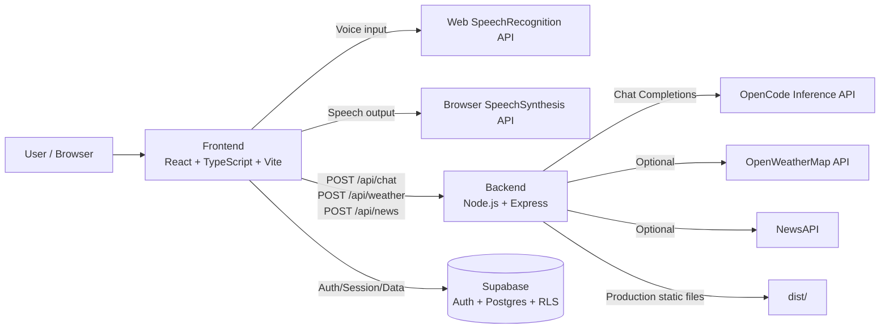

# SWAR AI — Architecture

## Overview

SWAR AI is a full-stack web application with a React + TypeScript frontend and an Express backend. The frontend handles UI, routing, speech recognition/synthesis, and Supabase client interactions. The backend exposes API endpoints for chat, weather, and news, and proxies AI requests to OpenCode Inference.

## System Architecture

## Frontend Architecture

| Area | Implementation | Location |
|---|---|---|
| App bootstrap | React app mounted with providers | `src/main.tsx` |
| Routing | React Router routes and protected route wrapper | `src/App.tsx` |
| Pages | Home, Assistant, Auth, Profile, Dashboard | `src/pages/` |
| UI components | Layout, marketing, voice assistant, mascot | `src/components/` |
| State/context | Auth, language, settings contexts | `src/context/` |
| Services | AI API, speech recognition/synthesis, Supabase, data store, safe storage | `src/services/` |
| i18n | Translation dictionary and language context | `src/i18n/translations.ts`, `src/context/LanguageContext.tsx` |
| Styling | Global dark theme CSS | `src/styles/global.css` |

## Backend Architecture

| Area | Implementation | Location |
|---|---|---|
| Server entry | Express app, middleware, routes, static serving | `server/index.js` |
| Chat endpoint | Validates messages, builds prompt, calls OpenCode Inference | `POST /api/chat` |
| Weather endpoint | Optional OpenWeatherMap proxy with rate limiting | `POST /api/weather` |
| News endpoint | Optional NewsAPI proxy with rate limiting | `POST /api/news` |
| Health endpoint | Configuration/runtime status | `GET /api/health` |
| Error handling | Structured fallback responses and provider error mapping | `server/index.js` |

## Data and Authentication

- **Supabase Auth:** email/password, Google OAuth initiation, password reset flows in frontend services.
- **Supabase DB:** schema in `supabase/schema.sql` defines `profiles`, `conversations`, `messages`, `memories`, `usage_events` with RLS policies.
- **Protected routes:** `/profile` and `/dashboard` require authenticated user in `App.tsx`.

## Request Flow (Chat)

1. User enters text or speech is transcribed in browser.
2. Frontend sends `POST /api/chat` with messages, language, mode, and optional context.
3. Backend builds system prompt and calls OpenCode Inference Chat Completions.
4. Backend parses/normalizes response to JSON (`reply`, `detectedLanguage`, `suggestions`, optional `memoryCandidate`).
5. Frontend renders response and optionally uses SpeechSynthesis for audio output.

## Security Considerations

- AI provider keys are read from backend environment variables.
- Frontend uses Supabase publishable/anon key only.
- `.env` is ignored by Git; `.env.example` uses placeholders.
- Supabase RLS policies restrict user-owned data access.
- External API endpoints include basic in-memory rate limiting.
