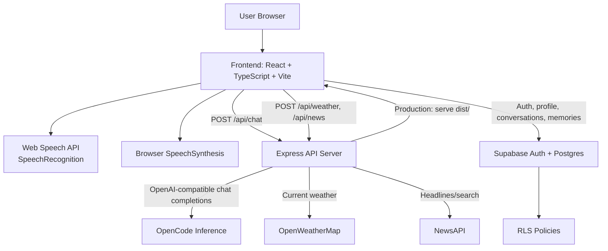

# SWAR AI Architecture

## Overview

SWAR AI is a full-stack web application with a React/Vite frontend and an Express backend. The backend proxies AI chat requests to OpenCode Inference, provides optional weather/news endpoints, and serves production static files. Supabase is used for authentication and user data storage.

## High-Level Architecture

## Frontend

- **Entry:** `src/main.tsx`, `src/App.tsx`
- **Routes:** `/`, `/assistant`, `/auth`, `/profile` (protected), `/dashboard` (protected)
- **State/contexts:** `AuthContext`, `LanguageContext`, `SettingsContext`
- **Key services:** `aiAssistant.ts`, `speechRecognition.ts`, `speechSynthesis.ts`, `supabase.ts`, `supabaseAuth.ts`, `dataStore.ts`, `safeStorage.ts`
- **UI:** Marketing sections, assistant chat/voice interface, auth/profile/dashboard pages, reusable `SwarAICircle`.

## Backend

- **Entry:** `server/index.js`
- **Endpoints:**
  - `GET /api/health` — configuration/status
  - `POST /api/chat` — validates input, adds prompt/context, calls OpenCode Inference, returns structured response
  - `POST /api/weather` — optional OpenWeatherMap integration
  - `POST /api/news` — optional NewsAPI integration
- **Behavior:** rate limiting, JSON extraction/fallback handling, safe error mapping, production static serving from `dist/`.

## Supabase

- **Schema:** `supabase/schema.sql`
- **Tables:** `profiles`, `conversations`, `messages`, `memories`, `usage_events`
- **Security:** Row Level Security policies restrict user-owned rows; auth user IDs are used as ownership keys.

## Environment Configuration

- Frontend Supabase vars: `VITE_SUPABASE_URL`, `VITE_SUPABASE_ANON_KEY`
- Backend AI vars: `AI_API_KEY`, `AI_API_URL`, `AI_MODEL`, `AI_VISION_MODEL`
- Optional external APIs: `WEATHER_API_KEY`, `NEWS_API_KEY`, `DEFAULT_WEATHER_LOCATION`

## Known Constraints

- Real AI responses require valid OpenCode Inference credentials and model access.
- SpeechRecognition/SpeechSynthesis behavior depends on browser support and permissions.
- Google OAuth requires Supabase provider enablement and correct Google Cloud redirect configuration.
- Weather/news require valid third-party API keys and are subject to external rate limits.
