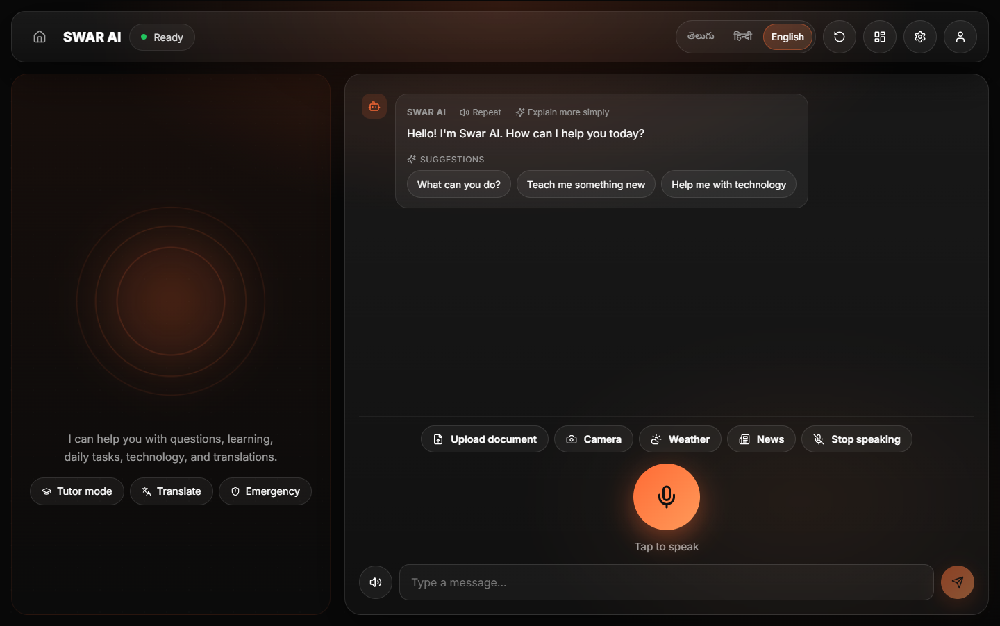
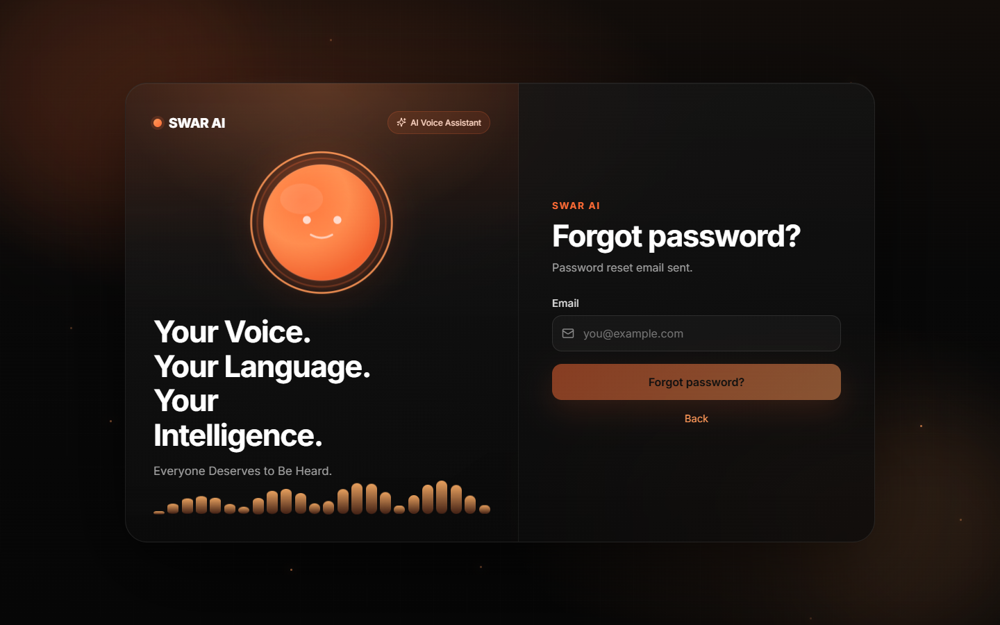
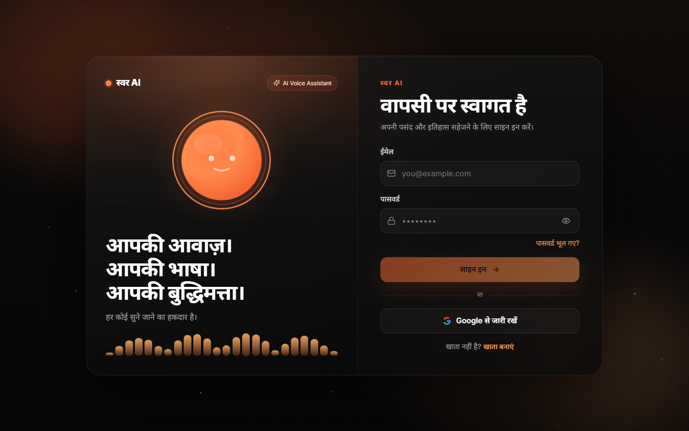
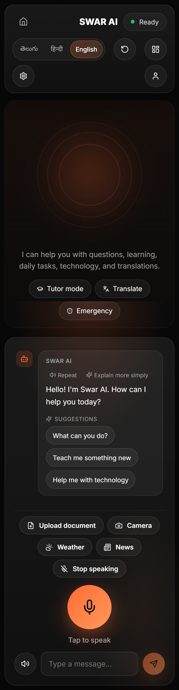
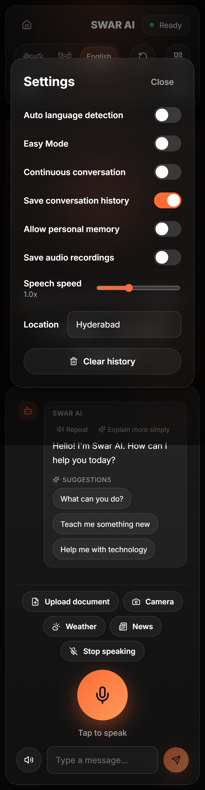

# SWAR AI Screenshots

Screenshots captured from the local development build on **November 24, 2026**.

- **Tool:** Puppeteer Core + Microsoft Edge (headless)
- **Desktop viewport:** 1440x900
- **Mobile viewport:** 390x844 (device scale 2)
- **App URL:** `http://localhost:5173`
- **Note:** `/profile` and `/dashboard` are protected routes. Without an authenticated session, the app correctly redirects to `/auth`; screenshots capture this real behavior.

## Desktop

### 01. Homepage

- **Route:** `/`
- **Description:** Marketing homepage introducing SWAR AI, voice-first multilingual positioning, hero CTA, and product sections.
- **Main elements:** Navbar, hero section with `SwarAICircle`, CTA buttons, feature/marketing sections, footer.

### 02. AI Assistant

- **Route:** `/assistant`
- **Description:** Main assistant interface for text/voice interaction.
- **Main elements:** Assistant orb/circle area, status bar, chat panel, microphone control, text input, settings/language controls.

### 03. Assistant Chat Input

- **Route:** `/assistant`
- **Description:** Assistant page with text input focused/ready for user message.
- **Main elements:** Chat input, send/control area, assistant conversation UI.

### 04. Language Selector

- **Route:** `/assistant`
- **Description:** Language selection UI on assistant experience.
- **Main elements:** Language selector control and assistant interface.

### 05. Assistant Settings

- **Route:** `/assistant`
- **Description:** Assistant settings panel/state.
- **Main elements:** Settings controls for assistant preferences.

### 06. Login

- **Route:** `/auth`
- **Description:** Authentication page with sign-in form and auth options.
- **Main elements:** Email/password fields, sign-in action, Google sign-in button, forgot password/create account links, `SwarAICircle` visual.

### 07. Registration

- **Route:** `/auth` (signup mode)
- **Description:** Account creation state in authentication UI.
- **Main elements:** Name/email/password inputs, create account action, auth navigation.

### 08. Forgot Password

- **Route:** `/auth` (reset mode)
- **Description:** Password reset request state.
- **Main elements:** Email input, reset action, navigation back to sign-in.

### 09. Profile Route (Redirect Behavior)

- **Route:** `/profile` (protected)
- **Description:** Real behavior when unauthenticated: route redirects to auth page.
- **Main elements:** Auth page shown after protected-route redirect.

### 10. Dashboard Route (Redirect Behavior)

- **Route:** `/dashboard` (protected)
- **Description:** Real behavior when unauthenticated: route redirects to auth page.
- **Main elements:** Auth page shown after protected-route redirect.

## Mobile

### 01. Homepage (Mobile)

- **Route:** `/`
- **Description:** Mobile responsive homepage layout.

### 02. AI Assistant (Mobile)

- **Route:** `/assistant`
- **Description:** Mobile assistant interface.

### 03. Login (Mobile)

- **Route:** `/auth`
- **Description:** Mobile login/auth layout.

### 04. Registration (Mobile)

- **Route:** `/auth` (signup mode)
- **Description:** Mobile registration state.

### 05. Assistant Settings (Mobile)

- **Route:** `/assistant`
- **Description:** Mobile assistant settings state.
