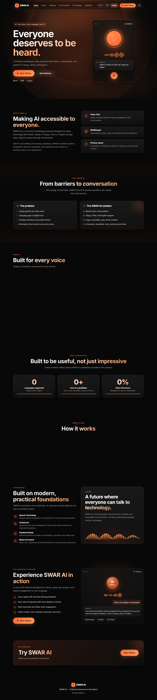
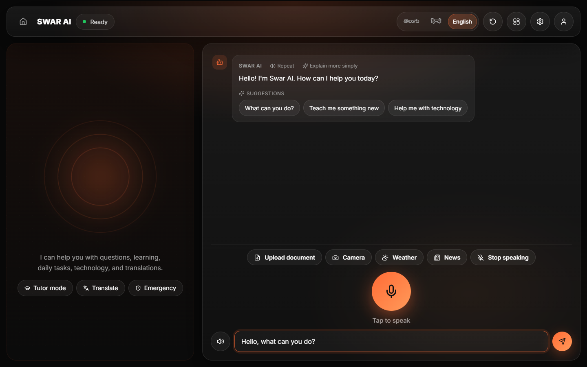
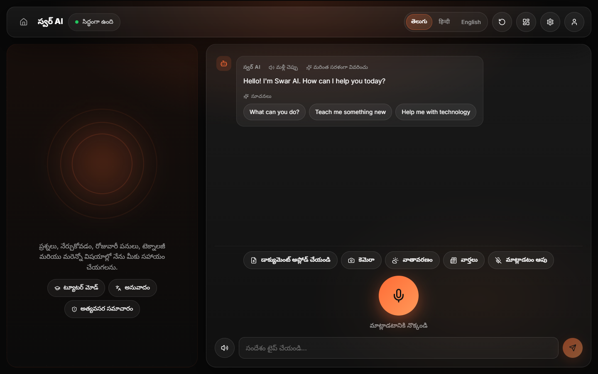
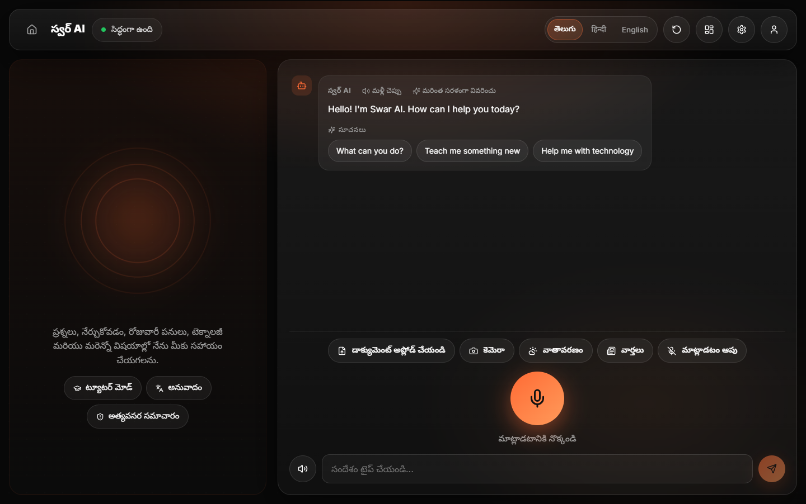
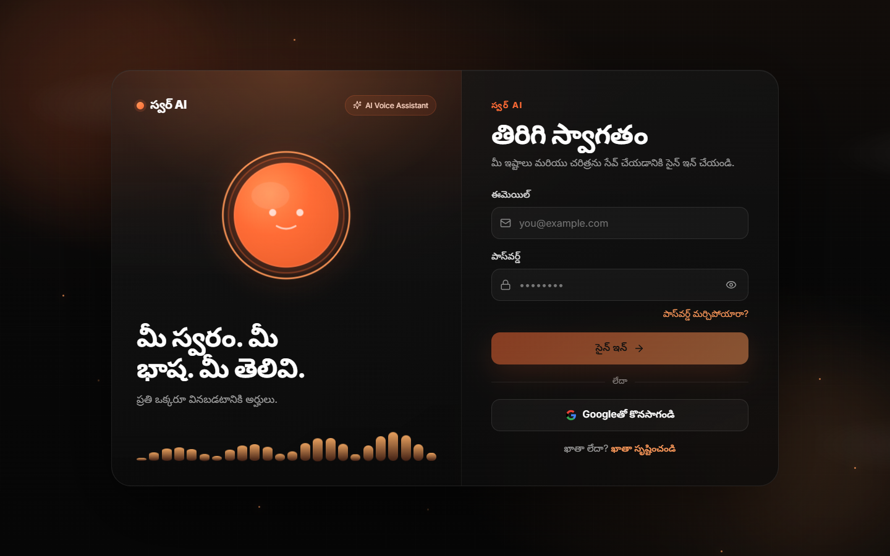
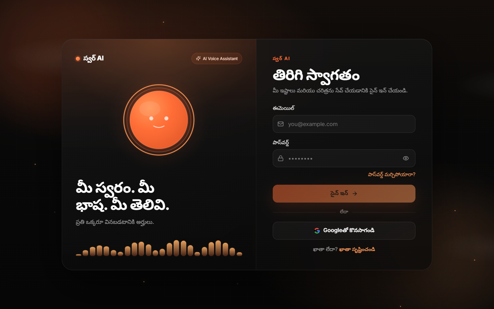

# SWAR AI — Application Screenshots

Screenshots captured from the local development build on **November 24, 2026**.

- **Tool:** Puppeteer Core + Microsoft Edge (headless)
- **Viewport:** 1440x900 (desktop/laptop)
- **Application URL:** `http://localhost:5173`
- **Notes:**
  - `/profile` and `/dashboard` are protected routes. Without an authenticated session, the application redirects to `/auth`; screenshots document this actual behavior.
  - No credentials, API keys, or private user data are exposed.
  - Only desktop/laptop screenshots are included.

## 01. Homepage

- **Route:** `/`
- **Purpose:** Introduce SWAR AI and provide entry points to the assistant and authentication flows.
- **Visible functionality:** Navigation bar, hero section with animated `SwarAICircle`, project tagline, call-to-action buttons, marketing sections (about/problem/features/stats/how-it-works/tech/preview/CTA), and footer.

## 02. AI Assistant

- **Route:** `/assistant`
- **Purpose:** Main conversational interface for text and voice interaction.
- **Visible functionality:** Assistant orb/circle, status bar, conversation panel, microphone control, text input, suggestion chips area, settings/language controls, and navigation.

## 03. Assistant Chat Input

- **Route:** `/assistant`
- **Purpose:** Shows the assistant interface with user text input interaction.
- **Visible functionality:** Chat input field, assistant UI controls, and conversation layout.

## 04. Language Selector

- **Route:** `/assistant`
- **Purpose:** Language selection for assistant interaction.
- **Visible functionality:** Language selector control and assistant interface context.

## 05. Assistant Settings

- **Route:** `/assistant`
- **Purpose:** Configure assistant behavior and user preferences.
- **Visible functionality:** Settings panel with assistant/user preference controls.

## 06. Login

- **Route:** `/auth`
- **Purpose:** Authenticate existing users.
- **Visible functionality:** Email/password fields, sign-in action, Google sign-in button, forgot-password link, create-account link, and auth visual with `SwarAICircle`.

## 07. Registration

- **Route:** `/auth` (signup mode)
- **Purpose:** Create a new account.
- **Visible functionality:** Name/email/password registration form, sign-up action, and navigation to sign-in.

## 08. Forgot Password

- **Route:** `/auth` (reset mode)
- **Purpose:** Request password reset email.
- **Visible functionality:** Email input, reset action, and navigation back to sign-in.

## 09. Profile Route (Protected Redirect)

- **Route:** `/profile` (protected)
- **Purpose:** User profile/settings page for authenticated users.
- **Captured state:** Unauthenticated access redirects to `/auth`. Screenshot documents actual redirect behavior because no authenticated demo session was used.

## 10. Dashboard Route (Protected Redirect)

- **Route:** `/dashboard` (protected)
- **Purpose:** User dashboard for conversations/memories/usage/privacy controls.
- **Captured state:** Unauthenticated access redirects to `/auth`. Screenshot documents actual redirect behavior because no authenticated demo session was used.
